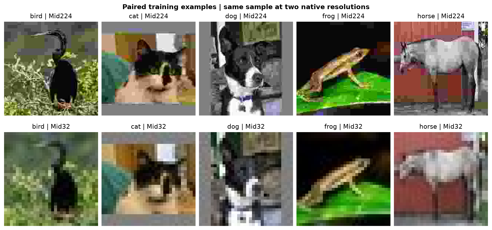
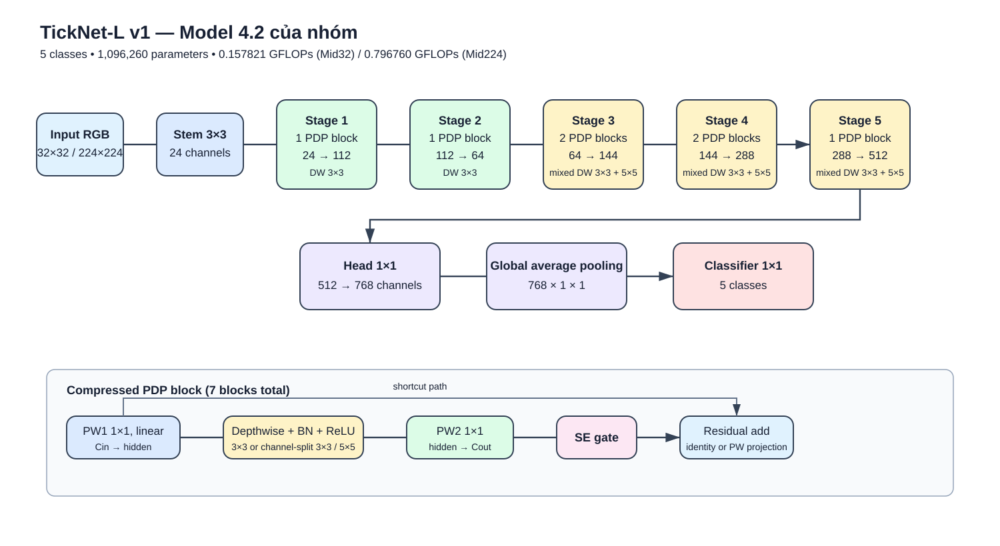
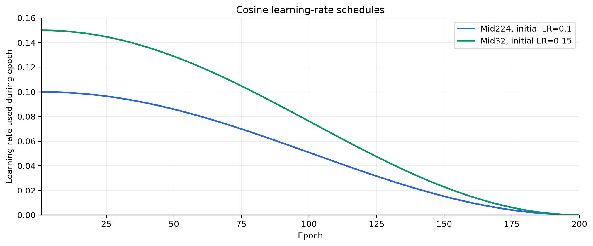
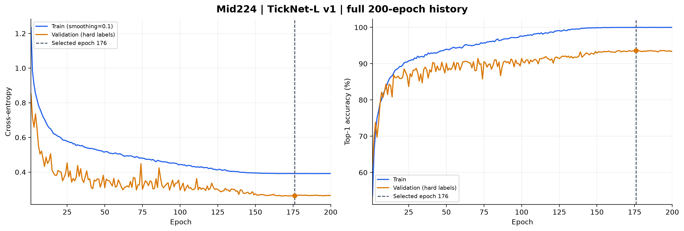
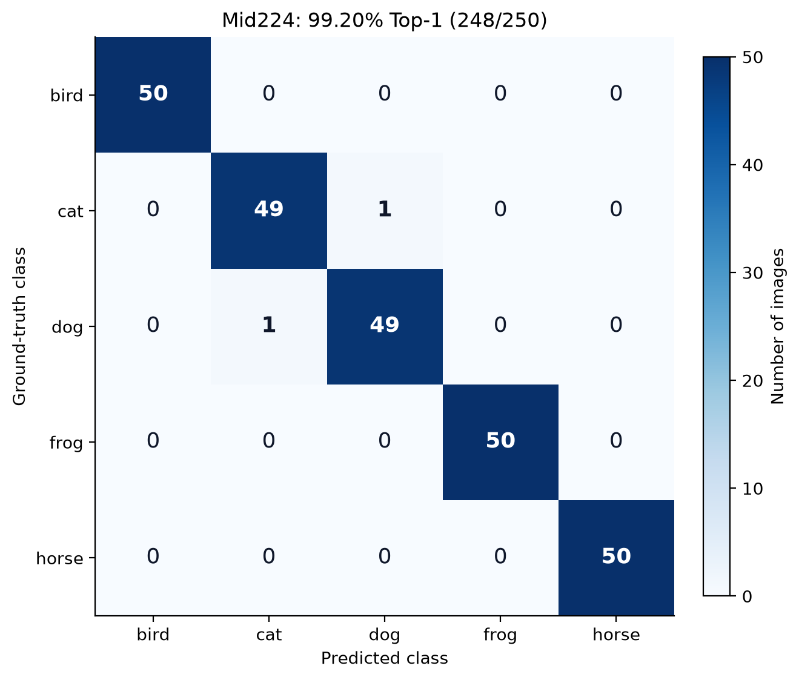
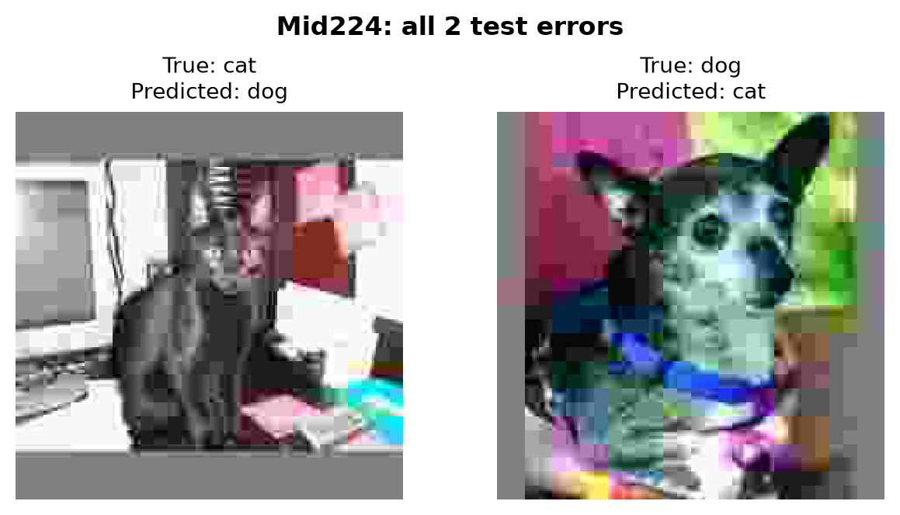
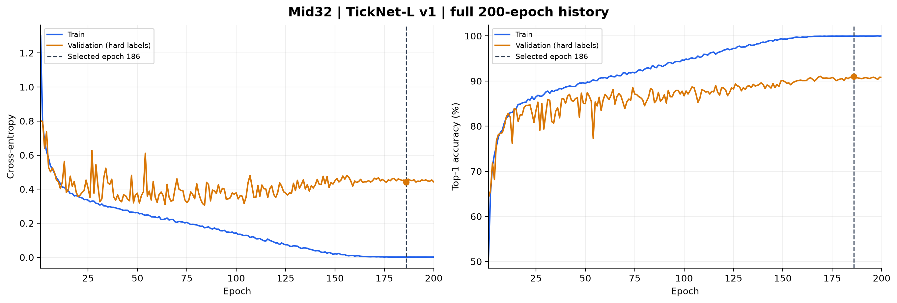
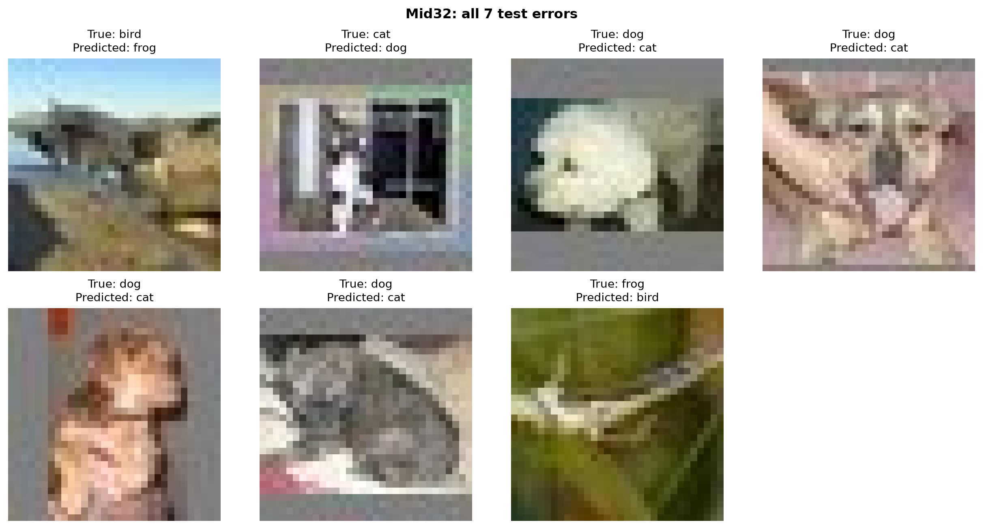
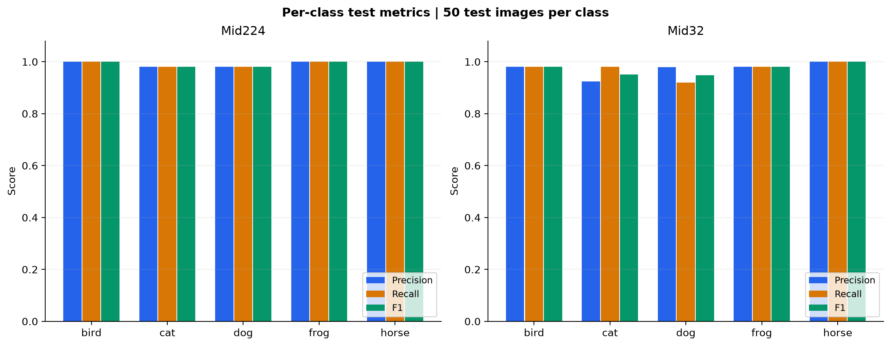

# BÁO CÁO GIỮA KỲ

## Thiết kế và đánh giá TickNet-L v1 trên Mid224 và Mid32

**Phạm vi:** phân loại ảnh năm lớp `bird`, `cat`, `dog`, `frog`, `horse`. Báo cáo tập trung vào TickNet-L v1 với 7 block và hai checkpoint được ghim để trình diễn kết quả giữa kỳ. Số liệu lấy từ config, lịch sử huấn luyện, dự đoán từng ảnh và log suy luận đã lưu; các hình được dựng lại từ những nguồn này.

Hai checkpoint trình diễn đạt **99,20% trên Mid224 (248/250)** và **97,20% trên Mid32 (243/250)**. Mô hình có **1.096.260 tham số học được**, chi phí **0,796760 GFLOPs trên Mid224** và **0,157821 GFLOPs trên Mid32**, theo quy ước đếm được nêu ở mục 3. Cần phân biệt checkpoint được ghim để báo cáo với cấu hình thắng theo validation; quy trình và giới hạn của lựa chọn được trình bày ở mục 6.

## Mục lục

1. [Đề bài và mục tiêu](#de-bai)
2. [Dữ liệu và tiền xử lý](#du-lieu)
3. [Thiết kế mô hình L](#mo-hinh)
4. [Thiết lập thực nghiệm](#thiet-lap)
5. [Kết quả hai checkpoint được chọn](#ket-qua)
6. [So sánh, thảo luận và kết luận](#so-sanh)
7. [Tài liệu tham khảo](#tham-khao)
8. [Phụ lục: checkpoint, lệnh chạy và đủ 200 epoch](#phu-luc)

<a id="de-bai"></a>

## 1. Đề bài và mục tiêu

Theo [đề giữa kỳ](<../.doc/Midterm exam.docx>), nhóm cần xây dựng bộ sưu tập ảnh có ít nhất năm lớp, mỗi lớp khoảng 5.000 ảnh huấn luyện và 50 ảnh kiểm tra; chuẩn bị hai phiên bản ảnh 224×224 và 32×32; thiết kế một mô hình nhẹ L; huấn luyện và báo cáo kết quả trên cả hai phiên bản.

| Hạng mục | Yêu cầu | Trọng số đánh giá |
|---|---|---:|
| Dataset | Mid224 224×224, giới hạn 25M; Mid32 32×32, giới hạn 20M | 20% |
| Mô hình L | Không quá 6 triệu tham số học được; FLOPs dưới 1G | 30% |
| Hiệu năng Mid224 | Báo cáo Top-1 và kết quả chi tiết | 20% |
| Hiệu năng Mid32 | Báo cáo Top-1 và kết quả chi tiết | 20% |
| Báo cáo | Tổng hợp phương pháp và kết quả thành PDF | 10% |

Đề còn yêu cầu kiến trúc đề xuất có khác biệt với các mạng có sẵn; các nhóm trùng kiến trúc hoặc dataset sẽ không được đánh giá. Báo cáo này mô tả cụ thể phần kế thừa từ TickNet và những thay đổi của L, thay vì coi SE, residual hay depthwise convolution là phát minh của nhóm.

Mục tiêu thực nghiệm là tìm được cấu hình phân loại có chi phí dưới giới hạn, giải thích được cách phân bổ tính toán, và cung cấp checkpoint cùng bằng chứng để chạy kiểm tra lại kết quả đã báo cáo.

<a id="du-lieu"></a>

## 2. Dữ liệu và tiền xử lý

### 2.1. Nguồn đầu vào và phạm vi dữ liệu

Dataset có năm lớp động vật: chim (`bird`), mèo (`cat`), chó (`dog`), ếch (`frog`) và ngựa (`horse`). Hồ sơ chuẩn bị dữ liệu ghi nhận nguồn đầu vào là bộ ảnh JPEG đã có sẵn ở thư mục `Final_Dataset_`, sau đó sao chép nguyên byte vào `data/`. Tên thư mục này là tên nguồn dữ liệu đầu vào, không phải một hạng mục dự án khác.

Pipeline hiện tại kiểm tra JPEG/RGB, kích thước, ghép cặp ảnh và checksum; nó không thực hiện lại resize hoặc nén JPEG. Hồ sơ chưa ghi đầy đủ nguồn công bố/thu thập ảnh gốc và tham số resize/nén trước đó, nên báo cáo không tự gán một nguồn công khai hoặc một thuật toán nội suy chưa được xác nhận.

### 2.2. Thống kê theo lớp

Mỗi phiên bản có **25.250 ảnh**: 25.000 ảnh thuộc tập train đóng gói và 250 ảnh thuộc tập test. Khi tuning, mỗi lớp tách 500 ảnh từ train làm validation, còn 4.500 ảnh để cập nhật trọng số.

| Lớp | Chỉ số nhãn | Train đóng gói | Train thực dùng khi tuning | Validation | Test |
|---|---:|---:|---:|---:|---:|
| bird | 0 | 5.000 | 4.500 | 500 | 50 |
| cat | 1 | 5.000 | 4.500 | 500 | 50 |
| dog | 2 | 5.000 | 4.500 | 500 | 50 |
| frog | 3 | 5.000 | 4.500 | 500 | 50 |
| horse | 4 | 5.000 | 4.500 | 500 | 50 |
| **Tổng mỗi độ phân giải** | | **25.000** | **22.500** | **2.500** | **250** |



*Hình 1. Một mẫu train của mỗi lớp ở hai độ phân giải. Hai hàng dùng cùng mã ảnh. Ảnh Mid32 được phóng lớn bằng nearest-neighbor khi hiển thị để quan sát; dữ liệu đầu vào mô hình vẫn là 32×32.*

### 2.3. Chia tập và kiểm định

Train/test được chia phân tầng theo lớp bằng seed **42**, chọn đúng 50 ảnh test/lớp. Hai độ phân giải được ghép cặp theo `class_name/filename`; membership chỉ được chọn một lần rồi áp dụng cho cả Mid224 và Mid32. Các thí nghiệm có validation sử dụng split seed **123**, độc lập với seed huấn luyện 42, và giữ cùng membership validation giữa hai độ phân giải.

Kiểm tra trong [split_config.json](../data/split_config.json) ghi nhận **0 nhóm ảnh trùng pixel chính xác xuyên train/test** ở mỗi phiên bản. Kết quả này không thay thế kiểm tra ảnh gần trùng hoặc cùng chủ thể. Audit pHash tìm thấy ba cặp trùng nhận thức nội bộ tập train; các cảnh báo nhãn từ bộ lọc pretrained chỉ là mẫu cần xem xét, không phải tỷ lệ sai nhãn ground truth đã xác nhận. Hai checkpoint trong báo cáo vẫn dùng các số lượng train/validation/test trong bảng trên.

### 2.4. Dung lượng và định dạng đóng gói

| Phiên bản | Kích thước ảnh | Tổng byte JPEG | Tổng JPEG (MB) | Gói TAR.XZ (MB) | Giới hạn đề |
|---|---|---:|---:|---:|---:|
| Mid224 | 224×224 | 31.803.510 | 31,803510 | **24,610144** | 25M |
| Mid32 | 32×32 | 19.057.221 | 19,057221 | **12,306416** | 20M |

MB trong bảng bằng 1.000.000 byte. **Mid224 nằm dưới 25 MB ở dạng gói TAR.XZ; tổng JPEG sau giải nén lớn hơn 25 MB.** Vì đề không định nghĩa rõ giới hạn áp dụng trước hay sau nén, báo cáo công khai cả hai giá trị. TAR.XZ bảo toàn byte JPEG khi giải nén.

### 2.5. Tiền xử lý

- Loader bắt buộc kích thước native 224×224 hoặc 32×32, không âm thầm resize khi đọc sai bộ dữ liệu.
- `ToTensor()` chuyển RGB từ [0,255] sang float trong [0,1]. Không dùng Normalize với mean/std ImageNet; mô hình có `data_bn` ở đầu vào.
- Train sử dụng `RandomCrop` với reflection padding `size//8`: 28 pixel cho Mid224 và 4 pixel cho Mid32; tiếp theo là horizontal flip xác suất 0,5.
- Validation và test không dùng augmentation ngẫu nhiên.

Nguồn: [mô tả dataset](02_dataset/DATASET_SPLIT.md), [kiểm định](02_dataset/DATASET_CLEANING.md), [tiền xử lý](02_dataset/PREPROCESSING.md) và [manifest chính thức](../data/split_manifest.csv).

<a id="mo-hinh"></a>

## 3. Thiết kế mô hình L

### 3.1. Kiến trúc nền và động lực

TickNet-L v1 được phát triển từ TickNet-Basic và cơ chế full-residual point-depth-point của TickNet [1]. Basic có lịch kênh dạng tick, gồm pointwise–depthwise–pointwise, SE attention, residual, global average pooling và classifier.

Ở ảnh 224×224, stage 2 của Basic tiêu tốn khoảng **0,521029 GFLOPs**, tương đương **52,7%** chi phí Conv/Linear toàn mạng. Nguyên nhân là pointwise đầu block chạy khi feature map còn 112×112, trước bước depthwise giảm kích thước. Thiết kế L giảm chi phí ở vùng này rồi phân bổ thêm block cho các stage có feature map nhỏ hơn.

### 3.2. Các thay đổi so với Basic

| Thành phần | TickNet-Basic | TickNet-L v1 |
|---|---|---|
| Stem | 32 kênh | 24 kênh |
| Kênh đầu ra năm stage | 128, 64, 128, 256, 512 | 112, 64, 144, 288, 512 |
| Số block mỗi stage | 1, 1, 1, 1, 1 | 1, 1, 2, 2, 1 |
| Tổng số block | 5 | 7 |
| Pointwise đầu block | Cin → Cin | Cin → hidden; xấp xỉ 0,75×Cin từ stage 2, làm tròn bội 8 |
| Depthwise | 3×3 | Stage 1–2: 3×3; stage 3–5: chia kênh cho 3×3 và 5×5 |
| Head | 1.024 kênh | 768 kênh |
| SE và residual | Có | Kế thừa |
| Đầu ra | 5 lớp | 5 lớp |

Mixed depthwise của L dựa trên ý tưởng dùng nhiều kích thước kernel trên các nhóm kênh [2]. Một nửa kênh chạy DW 3×3, nửa còn lại chạy DW 5×5, sau đó nối lại và trộn thông tin bằng pointwise. SE được kế thừa từ Basic và dùng trọng số theo kênh để điều chỉnh feature map [3].



*Hình 2. Kiến trúc L v1 với 7 block. Hai checkpoint được chọn đều dùng kiến trúc này; các số liệu của chúng không được gán cho ứng viên Midterm 10 block.*

### 3.3. Kích thước qua các stage

| Thành phần | Kênh đầu ra | Số block | Feature map Mid224 | Feature map Mid32 |
|---|---:|---:|---|---|
| Stem 3×3 | 24 | — | 112×112 | 32×32 |
| Stage 1 | 112 | 1 | 112×112 | 32×32 |
| Stage 2 | 64 | 1 | 56×56 | 32×32 |
| Stage 3 | 144 | 2 | 28×28 | 16×16 |
| Stage 4 | 288 | 2 | 14×14 | 8×8 |
| Stage 5 | 512 | 1 | 7×7 | 4×4 |
| Head 1×1 | 768 | — | 7×7 | 4×4 |
| Global average pooling | 768 | — | 1×1 | 1×1 |
| Classifier 1×1 | 5 | — | 1×1 | 1×1 |

Mid32 thay stride của stem và stage 2 để tránh giảm spatial quá sớm; lịch kênh và số block được giữ như Mid224.

### 3.4. Kiểm tra giới hạn đề bài

| Mô hình | Tham số học được | GFLOPs Mid224 | GFLOPs Mid32 |
|---|---:|---:|---:|
| Basic | 1.062.223 | 0,988343 | 0,158428 |
| **L v1** | **1.096.260** | **0,796760** | **0,157821** |
| Giới hạn đề | ≤6.000.000 | <1,000000 | <1,000000 |

L tăng khoảng **3,2% tham số** so với Basic, giảm khoảng **19,4% FLOPs trên Mid224** và **0,38% trên Mid32**. Stage 2 của L còn khoảng 0,332517 GFLOPs. Đóng góp được trình bày là cách kết hợp và phân bổ tài nguyên của biến thể L trên bài toán này, không phải phát minh SE hay mixed depthwise.

Quy ước phép đếm: một ảnh RGB, batch 1, eval forward, **1 MAC = 2 FLOPs**, chỉ cộng Conv2d và Linear, gồm các Linear trong SE. Không cộng BatchNorm, activation, pooling, residual addition, bias addition, nhân scale SE hoặc di chuyển dữ liệu. Vì vậy FLOPs ở đây không phải latency hoặc tổng mọi phép toán trên thiết bị. Mã đếm đã có đối chiếu với `FlopCounterMode`.

Nguồn: [implementation L](../models/ticknet_l.py), [thiết kế L](03_model/MODEL_L.md) và [model_profiles.json](03_model/model_profiles.json).

<a id="thiet-lap"></a>

## 4. Thiết lập thực nghiệm

### 4.1. Cấu hình hai lượt chạy được chọn

| Thiết lập | Mid224 | Mid32 |
|---|---|---|
| Run | `l_mid224_smoothing010` | `l_mid32_lr015` |
| Kiến trúc | TickNet-L v1, 7 block | TickNet-L v1, 7 block |
| Khởi tạo | Huấn luyện từ đầu | Huấn luyện từ đầu |
| Train / validation / test | 22.500 / 2.500 / 250 | 22.500 / 2.500 / 250 |
| Optimizer | SGD | SGD |
| LR ban đầu | **0,10** | **0,15** |
| Momentum | 0,9 | 0,9 |
| Weight decay | 0,0001 | 0,0001 |
| Train loss | Cross-entropy, smoothing **0,10** | Cross-entropy, smoothing **0** |
| Validation/test loss | Cross-entropy nhãn cứng, smoothing 0 | Cross-entropy nhãn cứng, smoothing 0 |
| Batch size train | 64 | 64 |
| DataLoader workers | 2 | 2 |
| Tổng epoch | **200** | **200** |
| Scheduler | CosineAnnealingLR, T_max=200, eta_min=0 | CosineAnnealingLR, T_max=200, eta_min=0 |
| Seed huấn luyện / split seed | 42 / 123 | 42 / 123 |
| Epoch checkpoint được chọn | **176** | **186** |
| Python ghi trong config | 3.13.15 | 3.12.13 |
| PyTorch / torchvision ghi trong config | 2.11.0+cu128 / 0.26.0+cu128 | 2.10.0+cu128 / 0.25.0+cu128 |
| Thiết bị huấn luyện ghi trong config | cuda:0 | cuda:0 |

Hai config không ghi tên GPU cụ thể. Khác biệt phiên bản môi trường và recipe được công khai; so sánh giữa hai độ phân giải không được coi là phép thử chỉ thay duy nhất kích thước ảnh.

Nguồn cấu hình: [Mid224](../checkpoints/l_mid224_smoothing010/config.json), [Mid32](../checkpoints/l_mid32_lr015/config.json). Hai lượt chạy này chưa phải lượt retrain toàn bộ 25.000 ảnh sau khi chọn recipe.

### 4.2. Chọn checkpoint và lịch học

Mỗi lượt chạy đủ 200 epoch. `best_val.pt` lưu epoch có validation Top-1 cao nhất; nếu bằng nhau thì chọn validation loss thấp hơn. `last.pt` là trạng thái cuối để resume, không tự động là checkpoint đánh giá của báo cáo. Với hai run đang xét, checkpoint tương ứng ở epoch 176 và 186.

Lịch cosine được thiết lập trên toàn bộ 200 epoch. Log ghi learning rate dùng trong từng epoch; vì scheduler cập nhật sau epoch, LR dùng tại epoch 200 còn dương rất nhỏ. Việc tiếp tục phiên chạy cần giữ nguyên lịch học và trạng thái optimizer/RNG theo [protocol](04_training/MIDTERM_PROTOCOL.md).



*Hình 3. Learning rate theo epoch, lấy trực tiếp từ hai file `epochs.csv`.*

### 4.3. Độ đo và cách đánh giá

Top-1 là số ảnh dự đoán đúng chia tổng số ảnh. Confusion matrix có **hàng là nhãn thật, cột là nhãn dự đoán**. Với mỗi lớp, báo cáo precision, recall và F1; Macro-F1 là trung bình F1 của năm lớp. F1 trong bảng được ghi theo thang 0–1, Top-1/precision/recall theo phần trăm.

Validation và test chạy ở `eval()` với nhãn cứng, không crop/flip ngẫu nhiên. Loss được tính trung bình theo số mẫu thực tế, bao gồm batch cuối. Không tạo test accuracy theo từng epoch để dùng như tín hiệu chọn điểm dừng.

<a id="ket-qua"></a>

## 5. Kết quả hai checkpoint được chọn

### 5.1. Tổng hợp kết quả

<!-- BEGIN SELECTED_RESULTS -->
| Dataset | Epoch chọn | Val Top-1 (%) | Test Top-1 (%) | Đúng | Macro-F1 | Test loss chạy lại | GFLOPs |
| --- | --- | --- | --- | --- | --- | --- | --- |
| Mid224 | 176 | 93.64 | 99.20 | 248/250 | 0.992000 | 0.132787 | 0.796760 |
| Mid32 | 186 | 91.04 | 97.20 | 243/250 | 0.971982 | 0.051236 | 0.157821 |
<!-- END SELECTED_RESULTS -->

Số liệu test trong bảng được đo lại trực tiếp từ hai bản trọng số ghim trên 250 ảnh test local, batch 16, bằng đúng implementation L v1 và transform của các script checkpoint. Top-1, confusion matrix và predictions từng ảnh được lưu cùng báo cáo; Macro-F1 tính từ confusion matrix, loss tính từ negative log-likelihood của từng ảnh. Kết quả đúng/sai cũng khớp log đã chạy bằng `checkpoint224.py`/`checkpoint32.py` ngày 16/10/2026.

Nguồn chính: [JSON chạy lại Mid224](05_results/selected_checkpoints/inference/mid224_test_metrics.json), [JSON chạy lại Mid32](05_results/selected_checkpoints/inference/mid32_test_metrics.json), [môi trường/checksum Mid224](05_results/selected_checkpoints/inference/mid224_metadata.json), [Mid32](05_results/selected_checkpoints/inference/mid32_metadata.json). Các giá trị loss lịch sử có thể khác nhẹ do môi trường/batch; bảng này thống nhất dùng kết quả của đợt suy luận dựng báo cáo.

### 5.2. Mid224 — L v1, label smoothing 0,10

#### Quá trình học và epoch được chọn



*Hình 4. Train/validation loss và Top-1 qua đủ 200 epoch; đường dọc đánh dấu epoch 176 được chọn trong run Mid224.*

<!-- BEGIN MID224_MILESTONES -->
| Epoch | LR | Train loss | Train Top-1 (%) | Val loss | Val Top-1 (%) |
| --- | --- | --- | --- | --- | --- |
| 1 | 0.1000000 | 1.235247 | 53.51 | 0.852107 | 61.84 |
| 25 | 0.0964888 | 0.577157 | 90.80 | 0.453129 | 83.68 |
| 50 | 0.0859063 | 0.515748 | 93.98 | 0.309475 | 90.08 |
| 75 | 0.0698574 | 0.479130 | 95.72 | 0.300881 | 90.56 |
| 100 | 0.0507854 | 0.443345 | 97.60 | 0.295622 | 91.44 |
| 125 | 0.0315938 | 0.413272 | 99.11 | 0.299671 | 91.40 |
| 150 | 0.0152044 | 0.394445 | 99.91 | 0.274548 | 92.88 |
| 175 | 0.0041123 | 0.391623 | 99.99 | 0.264787 | 93.48 |
| **176** | 0.0038060 | 0.391670 | 99.99 | 0.263301 | 93.64 |
| 200 | 0.0000062 | 0.391477 | 99.99 | 0.263730 | 93.48 |
<!-- END MID224_MILESTONES -->

Validation Top-1 tăng từ 61,84% ở epoch 1 lên 93,64% tại epoch 176. Train loss dùng label smoothing, còn validation loss dùng nhãn cứng; hai đường loss không có cùng phân phối mục tiêu. Với năm lớp và epsilon=0,10, mục tiêu lớp đúng là 0,92 và bốn lớp còn lại là 0,02. Entropy của phân phối này xấp xỉ 0,3897, nên train loss ổn định quanh 0,391 không đồng nghĩa mô hình chưa học được dữ liệu. Ý tưởng label smoothing được trình bày trong [4].

#### Confusion matrix và kết quả từng lớp



*Hình 5. Confusion matrix Mid224, tổng 250 ảnh; hàng là nhãn thật, cột là nhãn dự đoán. Mỗi hàng có đúng 50 ảnh.*

<!-- BEGIN MID224_CLASSES -->
| Lớp | Precision (%) | Recall (%) | F1 | Support | Đúng |
| --- | --- | --- | --- | --- | --- |
| bird | 100.00 | 100.00 | 1.000000 | 50 | 50 |
| cat | 98.00 | 98.00 | 0.980000 | 50 | 49 |
| dog | 98.00 | 98.00 | 0.980000 | 50 | 49 |
| frog | 100.00 | 100.00 | 1.000000 | 50 | 50 |
| horse | 100.00 | 100.00 | 1.000000 | 50 | 50 |
<!-- END MID224_CLASSES -->

Mô hình sai **hai ảnh**: một `cat` bị nhận thành `dog`, một `dog` bị nhận thành `cat`. Ba lớp bird, frog và horse đều đúng 50/50 trong tập test này. Nhận định này chỉ áp dụng cho 50 ảnh test/lớp đã đánh giá.



*Hình 6. Toàn bộ hai ảnh test Mid224 có dự đoán sai, lấy theo predictions đã khớp confusion matrix.*

### 5.3. Mid32 — L v1, learning rate 0,15

#### Quá trình học và epoch được chọn



*Hình 7. Train/validation loss và Top-1 qua đủ 200 epoch; đường dọc đánh dấu epoch 186 được chọn trong run Mid32.*

<!-- BEGIN MID32_MILESTONES -->
| Epoch | LR | Train loss | Train Top-1 (%) | Val loss | Val Top-1 (%) |
| --- | --- | --- | --- | --- | --- |
| 1 | 0.1500000 | 1.299967 | 50.98 | 0.801440 | 64.24 |
| 25 | 0.1447332 | 0.335954 | 86.49 | 0.407132 | 83.44 |
| 50 | 0.1288595 | 0.263283 | 89.44 | 0.376476 | 85.00 |
| 75 | 0.1047861 | 0.205152 | 91.80 | 0.321401 | 87.12 |
| 100 | 0.0761780 | 0.143624 | 94.59 | 0.378499 | 86.72 |
| 125 | 0.0473907 | 0.073916 | 97.25 | 0.377615 | 88.24 |
| 150 | 0.0228065 | 0.020764 | 99.27 | 0.449025 | 90.12 |
| 175 | 0.0061684 | 0.002041 | 99.97 | 0.448836 | 90.80 |
| **186** | 0.0020723 | 0.001766 | 99.96 | 0.441804 | 91.04 |
| 200 | 0.0000093 | 0.001580 | 99.99 | 0.443312 | 90.80 |
<!-- END MID32_MILESTONES -->

Validation Top-1 tăng từ 64,24% lên 91,04% tại epoch 186. Sau giai đoạn đầu, train loss tiếp tục giảm trong khi validation loss không giảm tương ứng. Đây là tín hiệu cần xem xét khả năng khái quát hóa; không dùng train accuracy gần 100% làm bằng chứng mô hình sẽ đạt gần 100% trên dữ liệu mới. Epoch cuối 200 có validation Top-1 90,80%, thấp hơn checkpoint đã chọn.

#### Confusion matrix và kết quả từng lớp


*Hình 8. Confusion matrix Mid32 trên cùng quy mô 250 ảnh test.*

<!-- BEGIN MID32_CLASSES -->
| Lớp | Precision (%) | Recall (%) | F1 | Support | Đúng |
| --- | --- | --- | --- | --- | --- |
| bird | 98.00 | 98.00 | 0.980000 | 50 | 49 |
| cat | 92.45 | 98.00 | 0.951456 | 50 | 49 |
| dog | 97.87 | 92.00 | 0.948454 | 50 | 46 |
| frog | 98.00 | 98.00 | 0.980000 | 50 | 49 |
| horse | 100.00 | 100.00 | 1.000000 | 50 | 50 |
<!-- END MID32_CLASSES -->

Mô hình sai **bảy ảnh**: bốn `dog` → `cat`, một `cat` → `dog`, một `bird` → `frog` và một `frog` → `bird`. Lớp dog có recall 92% và F1 thấp nhất trong năm lớp; precision của cat giảm vì nhận thêm bốn ảnh dog. Horse đúng 50/50, các lớp bird, cat và frog có recall 98%.



*Hình 9. Toàn bộ bảy ảnh test Mid32 có dự đoán sai. Ảnh được phóng lớn khi hiển thị; đầu vào đánh giá là 32×32. “True” là nhãn được cung cấp bởi dataset; báo cáo không tự sửa nhãn theo hình hiển thị hoặc dự đoán của mô hình.*

### 5.4. Đối chiếu hai checkpoint



*Hình 10. Chỉ số từng lớp của hai checkpoint, tính lại từ confusion matrix.*

Checkpoint Mid224 đúng nhiều hơn Mid32 **5 ảnh**, tương ứng **2,00 điểm phần trăm Top-1**. Cả hai đều tập trung lỗi ở cặp cat/dog; Mid32 có thêm nhầm bird/frog. Tuy nhiên hai run khác cả độ phân giải, learning rate và label smoothing, nên không quy toàn bộ chênh lệch này cho riêng độ phân giải.

<a id="so-sanh"></a>

## 6. So sánh, thảo luận và kết luận

### 6.1. So sánh kiến trúc lịch sử: Basic → L

Các kết quả dưới đây thuộc những lượt chạy lịch sử dùng đủ **25.000 ảnh train**, 200 epoch, seed 42 và checkpoint cuối. Chúng được trình bày riêng với nhóm tuning có 22.500 train + 2.500 validation.

<!-- BEGIN HISTORICAL_RESULTS -->
| Mô hình | Dataset | Batch | Test Top-1 (%) | Macro-F1 | Tham số | GFLOPs |
| --- | --- | --- | --- | --- | --- | --- |
| basic | Mid32 | 64 | 89.60 | 0.895598 | 1,062,223 | 0.158428 |
| basic | Mid224 | 64 | 92.40 | 0.923955 | 1,062,223 | 0.988343 |
| l | Mid32 | 128 | 91.60 | 0.915748 | 1,096,260 | 0.157821 |
| l | Mid224 | 64 | 95.60 | 0.955877 | 1,096,260 | 0.796760 |
<!-- END HISTORICAL_RESULTS -->

Trong các lượt này, L có Top-1 cao hơn Basic 2,0 điểm trên Mid32 và 3,2 điểm trên Mid224, đồng thời có FLOPs Mid224 thấp hơn. Đây là so sánh mô tả: L Mid32 dùng batch 128 thay vì 64, workers cũng khác, và nhiều thành phần kiến trúc đã đổi cùng lúc. Không dùng bảng để kết luận riêng mixed kernel hoặc riêng nén kênh gây ra toàn bộ mức tăng accuracy.

Nguồn: [reported_metrics.csv](05_results/model_comparison/reported_metrics.csv) và [biên bản audit](05_results/AUDIT_TICKNET_2026-10-01.md).

### 6.2. Hai hướng thử nghiệm Midterm

Các hướng sau chạy riêng với cùng quy mô 22.500 train, 2.500 validation, 250 test, seed 42 và split seed 123:

1. **Exp 1 — smoothing/LR:** thử epsilon 0,05/0,10 ở LR 0,10; thử LR 0,05/0,15 với epsilon 0. Mỗi recipe thay riêng một yếu tố.
2. **Exp 2 — stage 4 depth:** tăng stage 4 từ 2 lên 3 block, giữ recipe baseline.

Hai hướng dùng chung baseline và được đối chiếu độc lập; mỗi recipe thay riêng smoothing, learning rate hoặc độ sâu stage 4.

<!-- BEGIN ABLATION -->
| Cấu hình | Val Mid32 (%) | Val Mid224 (%) | Test Mid32 (%) | Test Mid224 (%) |
| --- | --- | --- | --- | --- |
| Baseline L | 90.40 | 93.88 | 92.40 | 96.80 |
| Smoothing 0.05 | 90.64 | 93.44 | 92.80 | 98.00 |
| Smoothing 0.10 | 90.72 | 93.64 | 94.40 | 99.20 |
| LR 0.05 | 90.56 | 93.32 | 95.60 | 96.00 |
| LR 0.15 | 91.04 | 93.84 | 97.20 | 96.80 |
| Stage 4: 3 block | 90.12 | 94.12 | 93.60 | 96.40 |
<!-- END ABLATION -->


*Hình 11. So sánh best validation Top-1 từ log/summary của từng recipe, theo cùng thứ tự cấu hình ở hai độ phân giải.*

Ở Mid32, LR 0,15 có validation Top-1 cao nhất trong bảng (91,04%). Ở Mid224, stage4-depth3 có validation Top-1 cao nhất (94,12%), nhưng test chỉ đạt 96,40%, thấp hơn baseline 96,80%. Các recipe smoothing/LR không vượt baseline Mid224 theo validation. Stage4-depth3 tăng tham số lên 1.236.030, GFLOPs lên 0,174237 trên Mid32 và 0,846991 trên Mid224; tín hiệu cải thiện không nhất quán giữa validation và test. Một seed chưa đủ để khẳng định lợi ích ổn định.

### 6.3. Giải trình lựa chọn hai checkpoint báo cáo

Cần phân biệt ba mức lựa chọn:

- **Epoch trong một run:** `best_val.pt` chọn theo validation. Hai checkpoint được ghim thuộc epoch 176 và 186, không phải trọng số epoch 200.
- **Recipe trong nhóm smoothing/LR:** [selection_lock.json](05_results/experiment_midterm_smoothing_lr/selection/selection_lock.json) khóa lựa chọn Mid32 LR 0,15 và Mid224 baseline trước đợt test của hồ sơ này.
- **Checkpoint trình diễn của nhóm:** root `checkpoint224.py` được ghim vào Mid224 smoothing 0,10 với test 99,2%; `checkpoint32.py` vào Mid32 LR 0,15 với test 97,2%.

Do đó, **không gọi Mid224 smoothing 0,10 là cấu hình thắng validation**. Việc ghim cấu hình này sau khi biết kết quả test là lựa chọn để trình diễn kết quả tốt nhất đã quan sát; nó không cung cấp một ước lượng test mới độc lập cho quy trình chọn recipe. Mid32 LR 0,15 có validation Top-1 cao nhất trong các cấu hình đang so sánh.

### 6.4. Hạn chế và độ tin cậy

- Mỗi recipe có một seed; chưa có mean±std qua nhiều lần train.
- Test gồm 250 ảnh, mỗi ảnh tương ứng 0,4 điểm phần trăm; historical test split đã được quan sát trong quá trình phát triển.
- Nguồn ảnh gốc và quy trình resize/nén ban đầu chưa được ghi đầy đủ; giới hạn dung lượng Mid224 hiện được đáp ứng ở gói nén.
- Hai run được chọn không có cùng phiên bản môi trường và recipe. FLOPs thấp không tự chứng minh latency thấp hơn nếu chưa đo trên cùng phần cứng.
- Số liệu trong bảng, confusion matrix và ảnh sai được đối chiếu từ artifact; điều này không thay thế một phép thử trên dataset mới.

### 6.5. Kết luận

TickNet-L v1 đáp ứng ngân sách tham số và FLOPs ở cả hai độ phân giải theo phạm vi đếm đã công bố. Thiết kế giảm chi phí ở stage đầu, bổ sung xử lý ở stage sau và giữ residual/SE từ kiến trúc nền. Hai checkpoint được ghim đạt 99,20% trên Mid224 và 97,20% trên Mid32 khi chạy kiểm tra lại trên tập test đã lưu.

Kết quả cho thấy cấu hình L có thể đạt độ chính xác cao trong bài toán năm lớp với khoảng 1,10 triệu tham số. Phần so sánh cũng cho thấy recipe thắng trên validation không nhất thiết trùng recipe có test cao nhất. Các bước kiểm chứng tiếp theo nên tập trung vào nhiều seed, xác nhận độc lập và làm đầy đủ hồ sơ nguồn dữ liệu, thay vì suy ra khả năng tổng quát hóa chỉ từ hai mức test Top-1.

<a id="tham-khao"></a>

## 7. Tài liệu tham khảo

1. Thanh Tuan Nguyen và Thanh Phuong Nguyen. *Efficient tick-shape networks of full-residual point-depth-point blocks for image classification*. Neurocomputing 596, 127942, 2024. [DOI](https://doi.org/10.1016/j.neucom.2024.127942). Nguồn kiến trúc nền TickNet/FR-PDP.
2. Mingxing Tan và Quoc V. Le. *MixConv: Mixed Depthwise Convolutional Kernels*, 2019. [arXiv:1907.09595](https://arxiv.org/abs/1907.09595). Nguồn ý tưởng mixed depthwise.
3. Jie Hu và cộng sự. *Squeeze-and-Excitation Networks*. [arXiv:1709.01507](https://arxiv.org/abs/1709.01507). Nguồn cơ chế SE đã được kế thừa.
4. Christian Szegedy và cộng sự. *Rethinking the Inception Architecture for Computer Vision*, 2015. [arXiv:1512.00567](https://arxiv.org/abs/1512.00567). Tham khảo label smoothing.

Các nguồn dự án dùng để tái tạo số liệu: [manifest dữ liệu](../data/split_manifest.csv), [config dataset](../data/split_config.json), [mã L v1](../models/ticknet_l.py), [protocol](04_training/MIDTERM_PROTOCOL.md), [hồ sơ smoothing/LR](05_results/experiment_midterm_smoothing_lr/README.md) và [log suy luận lại](08_appendix/validation/checkpoint_results.json). Phần tài liệu tham khảo này không thay thế việc bổ sung nguồn ảnh gốc khi nhóm xác nhận được thông tin đó.

<a id="phu-luc"></a>

## 8. Phụ lục

### 8.1. Chạy hai checkpoint được chọn

Từ thư mục gốc repo, dùng môi trường có PyTorch/torchvision:

```powershell
conda activate fresher
python checkpoint224.py
python checkpoint32.py
```

Đợt kiểm tra được lưu trong báo cáo dùng batch 16:

```powershell
python checkpoint224.py --batch-size 16
python checkpoint32.py --batch-size 16
```

Hai file chạy kiểm tra có thể nhận `--checkpoint`, `--data-root` và `--batch-size`. Chúng thực hiện suy luận, in params/FLOPs, cấu hình train, Top-1, Macro-F1, loss và confusion matrix; không huấn luyện lại.

<!-- BEGIN CHECKPOINT_HASHES -->
| Checkpoint | SHA-256 |
| --- | --- |
| `checkpoints/l_mid224_smoothing010/best_val.pt` | `7f648504064e442e4974943fd0ea70dce2ebe3a3caf7f9d4e41c054e815b4907` |
| `checkpoints/l_mid32_lr015/best_val.pt` | `c6d116d5d66bbded9de745e4f97ea38601049da42ce3fb8c2f6bb2f101105c42` |
<!-- END CHECKPOINT_HASHES -->

Hai file checkpoint ghim ở root khác byte với các bản trong hồ sơ smoothing/LR. Phép so sánh từng tensor trong `model_state_dict` cho kết quả dưới đây. Các hình và predictions trong báo cáo được dựng bằng suy luận trực tiếp từ bản ghim.

<!-- BEGIN CHECKPOINT_PARITY -->
| Dataset | Tensor trọng số ghim khớp bản hồ sơ |
| --- | --- |
| Mid224 | Có |
| Mid32 | Có |
<!-- END CHECKPOINT_PARITY -->

### 8.2. Nguồn hình, bảng và cách dựng lại

- [Metrics hai checkpoint](05_results/selected_checkpoints/tables/selected_checkpoint_metrics.csv).
- [Đủ 200 epoch Mid224](05_results/selected_checkpoints/tables/mid224_epochs.csv), [đủ 200 epoch Mid32](05_results/selected_checkpoints/tables/mid32_epochs.csv).
- [Confusion matrix Mid224](05_results/selected_checkpoints/tables/mid224_confusion_matrix.csv), [Mid32](05_results/selected_checkpoints/tables/mid32_confusion_matrix.csv).
- [Classification report Mid224](05_results/selected_checkpoints/tables/mid224_classification_report.csv), [Mid32](05_results/selected_checkpoints/tables/mid32_classification_report.csv).
- [Predictions Mid224](05_results/selected_checkpoints/tables/mid224_predictions.csv), [Mid32](05_results/selected_checkpoints/tables/mid32_predictions.csv).
- [Nguồn và checksum dùng dựng báo cáo](05_results/selected_checkpoints/provenance.json).
- [Kết quả kiểm thử sau khi sắp xếp repo](08_appendix/validation/test_results.json).

Để suy luận lại từ trọng số ghim, lưu dự đoán từng ảnh, dựng hình và cập nhật các bảng tự động trong chính file Markdown này:

```powershell
python scripts/build_midterm_report.py --evaluate
```

Nếu chỉ dựng lại hình và bảng từ bộ dự đoán đã lưu, chạy `python scripts/build_midterm_report.py`. Cả hai chế độ đều không huấn luyện hoặc chọn checkpoint mới. Script kiểm tra đủ epoch 1–200, đối chiếu predictions với confusion matrix, tính lại Top-1/precision/recall/F1 và so với log suy luận checkpoint đã lưu. Các bảng epoch phía dưới được sinh từ CSV đầy đủ, không nội suy hay làm mượt.

### 8.3. Lịch sử 200 epoch — Mid224

Epoch in đậm là checkpoint được chọn theo validation trong run. Train loss có smoothing 0,10; validation loss dùng nhãn cứng.

<details>
<summary>Mở bảng đủ 200 epoch Mid224</summary>

<!-- BEGIN MID224_FULL_EPOCHS -->
| Epoch | LR | Train loss | Train Top-1 (%) | Val loss | Val Top-1 (%) |
| --- | --- | --- | --- | --- | --- |
| 1 | 0.1000000 | 1.235247 | 53.51 | 0.852107 | 61.84 |
| 2 | 0.0999938 | 0.980099 | 65.65 | 0.714152 | 69.60 |
| 3 | 0.0999753 | 0.905347 | 71.08 | 0.659542 | 73.84 |
| 4 | 0.0999445 | 0.853079 | 75.00 | 0.735801 | 69.72 |
| 5 | 0.0999013 | 0.819968 | 76.87 | 0.651458 | 73.64 |
| 6 | 0.0998459 | 0.784273 | 79.15 | 0.550413 | 78.92 |
| 7 | 0.0997781 | 0.763609 | 80.05 | 0.503903 | 82.16 |
| 8 | 0.0996980 | 0.741214 | 81.54 | 0.521383 | 80.72 |
| 9 | 0.0996057 | 0.718988 | 82.52 | 0.476856 | 82.48 |
| 10 | 0.0995012 | 0.704605 | 83.51 | 0.432511 | 84.36 |
| 11 | 0.0993844 | 0.685338 | 84.67 | 0.486431 | 81.48 |
| 12 | 0.0992555 | 0.668090 | 85.68 | 0.449695 | 84.32 |
| 13 | 0.0991144 | 0.655896 | 86.32 | 0.465301 | 84.00 |
| 14 | 0.0989611 | 0.649328 | 86.64 | 0.505941 | 80.80 |
| 15 | 0.0987958 | 0.637056 | 87.40 | 0.413057 | 86.92 |
| 16 | 0.0986185 | 0.620744 | 88.21 | 0.392733 | 86.12 |
| 17 | 0.0984292 | 0.618709 | 88.42 | 0.381764 | 86.20 |
| 18 | 0.0982279 | 0.611899 | 88.69 | 0.381268 | 86.56 |
| 19 | 0.0980147 | 0.606467 | 89.21 | 0.408994 | 85.92 |
| 20 | 0.0977897 | 0.603074 | 89.18 | 0.403003 | 85.88 |
| 21 | 0.0975528 | 0.596546 | 89.63 | 0.399246 | 86.20 |
| 22 | 0.0973043 | 0.586280 | 90.25 | 0.349326 | 88.56 |
| 23 | 0.0970440 | 0.582897 | 90.41 | 0.368584 | 87.60 |
| 24 | 0.0967722 | 0.583089 | 90.42 | 0.393438 | 86.64 |
| 25 | 0.0964888 | 0.577157 | 90.80 | 0.453129 | 83.68 |
| 26 | 0.0961940 | 0.575039 | 90.85 | 0.372091 | 87.24 |
| 27 | 0.0958877 | 0.570567 | 91.08 | 0.406674 | 86.44 |
| 28 | 0.0955702 | 0.570721 | 91.02 | 0.341737 | 88.20 |
| 29 | 0.0952414 | 0.562659 | 91.58 | 0.363010 | 88.20 |
| 30 | 0.0949014 | 0.563095 | 91.42 | 0.349260 | 88.72 |
| 31 | 0.0945503 | 0.553286 | 92.05 | 0.369162 | 87.48 |
| 32 | 0.0941883 | 0.557102 | 91.73 | 0.438024 | 85.20 |
| 33 | 0.0938153 | 0.553750 | 91.95 | 0.375511 | 87.20 |
| 34 | 0.0934316 | 0.551299 | 91.96 | 0.419424 | 84.68 |
| 35 | 0.0930371 | 0.553546 | 91.83 | 0.357171 | 88.40 |
| 36 | 0.0926320 | 0.545545 | 92.50 | 0.339833 | 89.04 |
| 37 | 0.0922164 | 0.543634 | 92.38 | 0.371798 | 88.28 |
| 38 | 0.0917904 | 0.539485 | 92.93 | 0.406409 | 86.00 |
| 39 | 0.0913540 | 0.538810 | 92.72 | 0.356010 | 88.32 |
| 40 | 0.0909075 | 0.535181 | 92.96 | 0.360827 | 87.68 |
| 41 | 0.0904508 | 0.536818 | 92.84 | 0.311089 | 90.32 |
| 42 | 0.0899842 | 0.534265 | 93.00 | 0.304196 | 90.12 |
| 43 | 0.0895078 | 0.532784 | 92.90 | 0.354071 | 87.80 |
| 44 | 0.0890215 | 0.530358 | 93.00 | 0.348256 | 89.36 |
| 45 | 0.0885257 | 0.526691 | 93.28 | 0.360619 | 88.28 |
| 46 | 0.0880203 | 0.525120 | 93.47 | 0.358861 | 88.32 |
| 47 | 0.0875056 | 0.523055 | 93.55 | 0.312794 | 90.40 |
| 48 | 0.0869816 | 0.522782 | 93.61 | 0.340777 | 88.84 |
| 49 | 0.0864484 | 0.516250 | 93.83 | 0.381586 | 87.44 |
| 50 | 0.0859063 | 0.515748 | 93.98 | 0.309475 | 90.08 |
| 51 | 0.0853553 | 0.518565 | 93.90 | 0.359127 | 88.16 |
| 52 | 0.0847956 | 0.516142 | 93.81 | 0.351519 | 88.72 |
| 53 | 0.0842274 | 0.509352 | 94.19 | 0.349229 | 88.32 |
| 54 | 0.0836506 | 0.508716 | 94.35 | 0.334923 | 89.00 |
| 55 | 0.0830656 | 0.505934 | 94.52 | 0.319826 | 90.40 |
| 56 | 0.0824724 | 0.507346 | 94.28 | 0.363621 | 88.28 |
| 57 | 0.0818712 | 0.510547 | 94.36 | 0.313439 | 90.24 |
| 58 | 0.0812621 | 0.506070 | 94.42 | 0.318426 | 90.04 |
| 59 | 0.0806454 | 0.503877 | 94.55 | 0.355066 | 88.20 |
| 60 | 0.0800210 | 0.506223 | 94.28 | 0.336388 | 89.24 |
| 61 | 0.0793893 | 0.501617 | 94.57 | 0.314001 | 90.52 |
| 62 | 0.0787503 | 0.496082 | 95.06 | 0.297501 | 90.56 |
| 63 | 0.0781042 | 0.491253 | 95.29 | 0.310190 | 90.68 |
| 64 | 0.0774511 | 0.493438 | 95.10 | 0.314882 | 90.52 |
| 65 | 0.0767913 | 0.493830 | 95.05 | 0.319941 | 90.28 |
| 66 | 0.0761249 | 0.492776 | 95.03 | 0.313478 | 90.12 |
| 67 | 0.0754521 | 0.494535 | 94.94 | 0.346003 | 88.84 |
| 68 | 0.0747729 | 0.491616 | 95.04 | 0.311163 | 90.52 |
| 69 | 0.0740877 | 0.487753 | 95.16 | 0.368857 | 88.04 |
| 70 | 0.0733965 | 0.484645 | 95.37 | 0.365766 | 88.16 |
| 71 | 0.0726995 | 0.489378 | 95.27 | 0.296822 | 91.44 |
| 72 | 0.0719970 | 0.486052 | 95.36 | 0.326249 | 89.84 |
| 73 | 0.0712890 | 0.479664 | 95.75 | 0.325774 | 89.96 |
| 74 | 0.0705757 | 0.482056 | 95.61 | 0.447914 | 85.76 |
| 75 | 0.0698574 | 0.479130 | 95.72 | 0.300881 | 90.56 |
| 76 | 0.0691342 | 0.479900 | 95.70 | 0.326877 | 90.16 |
| 77 | 0.0684062 | 0.474385 | 95.98 | 0.349843 | 89.04 |
| 78 | 0.0676737 | 0.473283 | 96.00 | 0.339738 | 89.76 |
| 79 | 0.0669369 | 0.473538 | 96.12 | 0.321642 | 89.92 |
| 80 | 0.0661959 | 0.473156 | 96.06 | 0.348758 | 88.44 |
| 81 | 0.0654508 | 0.469236 | 96.24 | 0.345287 | 89.48 |
| 82 | 0.0647020 | 0.472911 | 96.04 | 0.302417 | 91.00 |
| 83 | 0.0639496 | 0.465358 | 96.52 | 0.306065 | 91.08 |
| 84 | 0.0631937 | 0.459842 | 96.80 | 0.361347 | 89.16 |
| 85 | 0.0624345 | 0.467768 | 96.35 | 0.311007 | 90.44 |
| 86 | 0.0616723 | 0.464730 | 96.43 | 0.424056 | 86.68 |
| 87 | 0.0609072 | 0.462187 | 96.60 | 0.366828 | 89.04 |
| 88 | 0.0601394 | 0.459723 | 96.79 | 0.320991 | 90.48 |
| 89 | 0.0593691 | 0.459108 | 96.82 | 0.309095 | 90.68 |
| 90 | 0.0585965 | 0.458824 | 96.85 | 0.320837 | 90.32 |
| 91 | 0.0578217 | 0.457926 | 96.84 | 0.330348 | 90.56 |
| 92 | 0.0570451 | 0.454447 | 97.02 | 0.337872 | 89.96 |
| 93 | 0.0562667 | 0.451641 | 97.20 | 0.295510 | 91.28 |
| 94 | 0.0554867 | 0.452327 | 97.20 | 0.325133 | 90.72 |
| 95 | 0.0547054 | 0.452360 | 97.19 | 0.353458 | 89.12 |
| 96 | 0.0539230 | 0.451669 | 97.16 | 0.314791 | 91.00 |
| 97 | 0.0531395 | 0.450326 | 97.20 | 0.336036 | 90.04 |
| 98 | 0.0523553 | 0.448120 | 97.30 | 0.336584 | 90.00 |
| 99 | 0.0515705 | 0.441960 | 97.63 | 0.353581 | 89.36 |
| 100 | 0.0507854 | 0.443345 | 97.60 | 0.295622 | 91.44 |
| 101 | 0.0500000 | 0.443574 | 97.53 | 0.314881 | 90.44 |
| 102 | 0.0492146 | 0.440500 | 97.74 | 0.336397 | 90.24 |
| 103 | 0.0484295 | 0.441535 | 97.66 | 0.290530 | 91.00 |
| 104 | 0.0476447 | 0.435550 | 97.89 | 0.308865 | 91.04 |
| 105 | 0.0468605 | 0.437866 | 97.83 | 0.324840 | 89.96 |
| 106 | 0.0460770 | 0.437951 | 97.96 | 0.306952 | 91.00 |
| 107 | 0.0452946 | 0.437500 | 97.83 | 0.310277 | 90.52 |
| 108 | 0.0445133 | 0.431516 | 98.16 | 0.299261 | 90.96 |
| 109 | 0.0437333 | 0.431544 | 98.21 | 0.298432 | 91.20 |
| 110 | 0.0429549 | 0.430537 | 98.24 | 0.307803 | 90.84 |
| 111 | 0.0421783 | 0.428411 | 98.38 | 0.362305 | 89.96 |
| 112 | 0.0414035 | 0.430529 | 98.21 | 0.298126 | 91.36 |
| 113 | 0.0406309 | 0.426905 | 98.50 | 0.312516 | 91.36 |
| 114 | 0.0398606 | 0.430601 | 98.12 | 0.300212 | 91.48 |
| 115 | 0.0390928 | 0.427374 | 98.39 | 0.307515 | 91.64 |
| 116 | 0.0383277 | 0.424536 | 98.51 | 0.302896 | 91.96 |
| 117 | 0.0375655 | 0.426594 | 98.37 | 0.293906 | 91.48 |
| 118 | 0.0368063 | 0.425346 | 98.51 | 0.319724 | 91.28 |
| 119 | 0.0360504 | 0.420273 | 98.73 | 0.297189 | 90.96 |
| 120 | 0.0352980 | 0.421729 | 98.71 | 0.306320 | 91.32 |
| 121 | 0.0345492 | 0.422042 | 98.59 | 0.335890 | 90.16 |
| 122 | 0.0338041 | 0.415421 | 98.96 | 0.313682 | 91.56 |
| 123 | 0.0330631 | 0.416326 | 98.99 | 0.299715 | 91.84 |
| 124 | 0.0323263 | 0.412958 | 99.10 | 0.303025 | 91.60 |
| 125 | 0.0315938 | 0.413272 | 99.11 | 0.299671 | 91.40 |
| 126 | 0.0308658 | 0.416049 | 98.96 | 0.293277 | 91.72 |
| 127 | 0.0301426 | 0.414021 | 99.04 | 0.285898 | 92.08 |
| 128 | 0.0294243 | 0.409342 | 99.28 | 0.290202 | 91.96 |
| 129 | 0.0287110 | 0.411929 | 99.14 | 0.291857 | 92.12 |
| 130 | 0.0280030 | 0.413195 | 99.09 | 0.305427 | 91.80 |
| 131 | 0.0273005 | 0.406662 | 99.43 | 0.296632 | 92.08 |
| 132 | 0.0266035 | 0.406829 | 99.28 | 0.296949 | 91.64 |
| 133 | 0.0259123 | 0.404371 | 99.51 | 0.287616 | 92.00 |
| 134 | 0.0252271 | 0.404135 | 99.49 | 0.302312 | 91.52 |
| 135 | 0.0245479 | 0.403783 | 99.53 | 0.300536 | 91.80 |
| 136 | 0.0238751 | 0.403927 | 99.52 | 0.300266 | 91.76 |
| 137 | 0.0232087 | 0.402325 | 99.59 | 0.289487 | 91.76 |
| 138 | 0.0225489 | 0.402772 | 99.52 | 0.291099 | 92.08 |
| 139 | 0.0218958 | 0.401058 | 99.64 | 0.271067 | 93.24 |
| 140 | 0.0212497 | 0.398250 | 99.76 | 0.298055 | 91.80 |
| 141 | 0.0206107 | 0.398637 | 99.73 | 0.294698 | 92.12 |
| 142 | 0.0199790 | 0.398369 | 99.79 | 0.277802 | 92.56 |
| 143 | 0.0193546 | 0.397640 | 99.81 | 0.276596 | 92.96 |
| 144 | 0.0187379 | 0.396421 | 99.82 | 0.280046 | 92.72 |
| 145 | 0.0181288 | 0.395644 | 99.88 | 0.283810 | 92.44 |
| 146 | 0.0175276 | 0.396044 | 99.82 | 0.274152 | 92.88 |
| 147 | 0.0169344 | 0.395153 | 99.88 | 0.277106 | 92.76 |
| 148 | 0.0163494 | 0.395512 | 99.87 | 0.286688 | 92.64 |
| 149 | 0.0157726 | 0.395404 | 99.88 | 0.268452 | 93.32 |
| 150 | 0.0152044 | 0.394445 | 99.91 | 0.274548 | 92.88 |
| 151 | 0.0146447 | 0.394184 | 99.91 | 0.266892 | 93.32 |
| 152 | 0.0140937 | 0.394099 | 99.88 | 0.266784 | 93.16 |
| 153 | 0.0135516 | 0.394061 | 99.90 | 0.269232 | 93.24 |
| 154 | 0.0130184 | 0.393186 | 99.96 | 0.270291 | 93.20 |
| 155 | 0.0124944 | 0.392925 | 99.96 | 0.269885 | 93.40 |
| 156 | 0.0119797 | 0.392920 | 99.96 | 0.267962 | 93.24 |
| 157 | 0.0114743 | 0.392992 | 99.96 | 0.264490 | 93.36 |
| 158 | 0.0109785 | 0.392818 | 99.94 | 0.265258 | 93.48 |
| 159 | 0.0104922 | 0.392832 | 99.96 | 0.264800 | 93.20 |
| 160 | 0.0100158 | 0.392282 | 99.99 | 0.268195 | 93.24 |
| 161 | 0.0095492 | 0.392534 | 99.96 | 0.267525 | 93.16 |
| 162 | 0.0090925 | 0.392372 | 99.98 | 0.272118 | 93.12 |
| 163 | 0.0086460 | 0.391901 | 99.99 | 0.264897 | 93.40 |
| 164 | 0.0082096 | 0.392037 | 99.97 | 0.264701 | 93.56 |
| 165 | 0.0077836 | 0.391809 | 99.98 | 0.263138 | 93.60 |
| 166 | 0.0073680 | 0.391844 | 99.98 | 0.265776 | 93.24 |
| 167 | 0.0069629 | 0.391930 | 99.98 | 0.262206 | 93.40 |
| 168 | 0.0065684 | 0.391970 | 99.98 | 0.261756 | 93.44 |
| 169 | 0.0061847 | 0.392002 | 99.98 | 0.262869 | 93.36 |
| 170 | 0.0058117 | 0.391875 | 99.98 | 0.263759 | 93.32 |
| 171 | 0.0054497 | 0.391754 | 99.98 | 0.263128 | 93.56 |
| 172 | 0.0050986 | 0.392032 | 99.98 | 0.262502 | 93.52 |
| 173 | 0.0047586 | 0.391988 | 99.97 | 0.262576 | 93.40 |
| 174 | 0.0044298 | 0.391666 | 99.99 | 0.263152 | 93.52 |
| 175 | 0.0041123 | 0.391623 | 99.99 | 0.264787 | 93.48 |
| **176** | 0.0038060 | 0.391670 | 99.99 | 0.263301 | 93.64 |
| 177 | 0.0035112 | 0.391669 | 99.98 | 0.265287 | 93.56 |
| 178 | 0.0032278 | 0.391330 | 100.00 | 0.265121 | 93.56 |
| 179 | 0.0029560 | 0.391558 | 100.00 | 0.267278 | 93.40 |
| 180 | 0.0026957 | 0.391527 | 100.00 | 0.266452 | 93.32 |
| 181 | 0.0024472 | 0.391512 | 99.99 | 0.265846 | 93.48 |
| 182 | 0.0022103 | 0.391611 | 99.99 | 0.265694 | 93.36 |
| 183 | 0.0019853 | 0.391939 | 99.98 | 0.266756 | 93.52 |
| 184 | 0.0017721 | 0.391471 | 100.00 | 0.265550 | 93.48 |
| 185 | 0.0015708 | 0.391534 | 100.00 | 0.265333 | 93.60 |
| 186 | 0.0013815 | 0.391552 | 99.99 | 0.263711 | 93.56 |
| 187 | 0.0012042 | 0.391501 | 99.99 | 0.265047 | 93.52 |
| 188 | 0.0010389 | 0.391223 | 100.00 | 0.265153 | 93.44 |
| 189 | 0.0008856 | 0.391274 | 100.00 | 0.264980 | 93.48 |
| 190 | 0.0007445 | 0.391491 | 99.99 | 0.266689 | 93.28 |
| 191 | 0.0006156 | 0.391495 | 99.99 | 0.265746 | 93.32 |
| 192 | 0.0004988 | 0.391381 | 100.00 | 0.263806 | 93.64 |
| 193 | 0.0003943 | 0.391525 | 99.99 | 0.265232 | 93.52 |
| 194 | 0.0003020 | 0.391664 | 99.98 | 0.263731 | 93.64 |
| 195 | 0.0002219 | 0.391499 | 100.00 | 0.263164 | 93.56 |
| 196 | 0.0001541 | 0.391577 | 99.98 | 0.264609 | 93.44 |
| 197 | 0.0000987 | 0.391459 | 99.98 | 0.263837 | 93.44 |
| 198 | 0.0000555 | 0.391358 | 100.00 | 0.265252 | 93.56 |
| 199 | 0.0000247 | 0.391433 | 100.00 | 0.265052 | 93.36 |
| 200 | 0.0000062 | 0.391477 | 99.99 | 0.263730 | 93.48 |
<!-- END MID224_FULL_EPOCHS -->

</details>

### 8.4. Lịch sử 200 epoch — Mid32

Epoch in đậm là checkpoint được chọn theo validation trong run. Train và validation đều dùng cross-entropy không smoothing.

<details>
<summary>Mở bảng đủ 200 epoch Mid32</summary>

<!-- BEGIN MID32_FULL_EPOCHS -->
| Epoch | LR | Train loss | Train Top-1 (%) | Val loss | Val Top-1 (%) |
| --- | --- | --- | --- | --- | --- |
| 1 | 0.1500000 | 1.299967 | 50.98 | 0.801440 | 64.24 |
| 2 | 0.1499907 | 0.793195 | 65.15 | 0.797638 | 65.68 |
| 3 | 0.1499630 | 0.679549 | 71.16 | 0.639822 | 71.88 |
| 4 | 0.1499167 | 0.620845 | 73.76 | 0.736832 | 68.16 |
| 5 | 0.1498520 | 0.582595 | 75.55 | 0.528197 | 76.80 |
| 6 | 0.1497688 | 0.536072 | 77.64 | 0.502210 | 78.16 |
| 7 | 0.1496671 | 0.518025 | 78.59 | 0.524689 | 78.40 |
| 8 | 0.1495471 | 0.494937 | 79.19 | 0.499157 | 78.56 |
| 9 | 0.1494086 | 0.466797 | 80.72 | 0.453972 | 79.96 |
| 10 | 0.1492518 | 0.451336 | 81.82 | 0.443604 | 82.08 |
| 11 | 0.1490766 | 0.431949 | 82.25 | 0.403504 | 82.84 |
| 12 | 0.1488832 | 0.412448 | 83.05 | 0.442857 | 81.96 |
| 13 | 0.1486715 | 0.410453 | 83.06 | 0.563085 | 76.20 |
| 14 | 0.1484417 | 0.398329 | 83.68 | 0.381167 | 83.92 |
| 15 | 0.1481938 | 0.391101 | 83.91 | 0.392851 | 83.68 |
| 16 | 0.1479277 | 0.373838 | 84.82 | 0.476566 | 81.04 |
| 17 | 0.1476437 | 0.375766 | 84.88 | 0.417867 | 82.48 |
| 18 | 0.1473418 | 0.360570 | 85.12 | 0.445295 | 82.48 |
| 19 | 0.1470220 | 0.362961 | 85.28 | 0.382569 | 84.12 |
| 20 | 0.1466845 | 0.356642 | 85.32 | 0.356607 | 84.60 |
| 21 | 0.1463292 | 0.352340 | 85.96 | 0.365819 | 84.60 |
| 22 | 0.1459564 | 0.348436 | 85.78 | 0.380360 | 84.72 |
| 23 | 0.1455661 | 0.338563 | 86.51 | 0.391621 | 82.92 |
| 24 | 0.1451583 | 0.339613 | 85.92 | 0.453482 | 80.84 |
| 25 | 0.1447332 | 0.335954 | 86.49 | 0.407132 | 83.44 |
| 26 | 0.1442910 | 0.325836 | 86.84 | 0.351949 | 85.32 |
| 27 | 0.1438316 | 0.330432 | 86.65 | 0.627963 | 79.12 |
| 28 | 0.1433552 | 0.329922 | 86.66 | 0.376817 | 85.00 |
| 29 | 0.1428620 | 0.317911 | 87.04 | 0.543753 | 79.36 |
| 30 | 0.1423521 | 0.315203 | 87.56 | 0.420976 | 82.80 |
| 31 | 0.1418255 | 0.306896 | 87.78 | 0.326256 | 85.92 |
| 32 | 0.1412824 | 0.313338 | 87.26 | 0.343366 | 85.72 |
| 33 | 0.1407230 | 0.301973 | 87.86 | 0.468776 | 81.00 |
| 34 | 0.1401474 | 0.301523 | 87.68 | 0.523141 | 80.68 |
| 35 | 0.1395557 | 0.295516 | 87.96 | 0.437913 | 83.28 |
| 36 | 0.1389480 | 0.297338 | 87.98 | 0.428317 | 84.08 |
| 37 | 0.1383246 | 0.293614 | 88.38 | 0.458706 | 81.84 |
| 38 | 0.1376856 | 0.293216 | 88.23 | 0.353750 | 86.00 |
| 39 | 0.1370310 | 0.290449 | 88.45 | 0.335746 | 86.12 |
| 40 | 0.1363612 | 0.286096 | 88.67 | 0.367042 | 85.04 |
| 41 | 0.1356763 | 0.284359 | 88.76 | 0.334977 | 86.64 |
| 42 | 0.1349763 | 0.279627 | 88.91 | 0.326268 | 87.04 |
| 43 | 0.1342616 | 0.275596 | 88.82 | 0.366689 | 85.68 |
| 44 | 0.1335323 | 0.276288 | 88.80 | 0.362249 | 85.52 |
| 45 | 0.1327885 | 0.275945 | 88.80 | 0.342180 | 86.12 |
| 46 | 0.1320304 | 0.265648 | 89.26 | 0.332273 | 86.28 |
| 47 | 0.1312583 | 0.265433 | 89.54 | 0.481559 | 81.96 |
| 48 | 0.1304723 | 0.264440 | 89.56 | 0.319910 | 87.32 |
| 49 | 0.1296726 | 0.261712 | 89.61 | 0.367762 | 85.08 |
| 50 | 0.1288595 | 0.263283 | 89.44 | 0.376476 | 85.00 |
| 51 | 0.1280330 | 0.255377 | 89.80 | 0.318916 | 87.44 |
| 52 | 0.1271935 | 0.257372 | 89.67 | 0.362023 | 86.60 |
| 53 | 0.1263410 | 0.250449 | 90.01 | 0.384533 | 85.56 |
| 54 | 0.1254759 | 0.247263 | 90.26 | 0.611039 | 77.28 |
| 55 | 0.1245984 | 0.249215 | 90.09 | 0.359374 | 85.36 |
| 56 | 0.1237086 | 0.246366 | 90.07 | 0.388545 | 84.48 |
| 57 | 0.1228068 | 0.237900 | 90.58 | 0.336524 | 86.40 |
| 58 | 0.1218932 | 0.237608 | 90.70 | 0.445523 | 83.48 |
| 59 | 0.1209680 | 0.237138 | 90.69 | 0.353080 | 85.76 |
| 60 | 0.1200315 | 0.232582 | 90.78 | 0.322403 | 87.04 |
| 61 | 0.1190839 | 0.239198 | 90.57 | 0.370212 | 86.48 |
| 62 | 0.1181254 | 0.222050 | 90.96 | 0.383365 | 85.92 |
| 63 | 0.1171563 | 0.222484 | 91.15 | 0.363060 | 86.80 |
| 64 | 0.1161767 | 0.225206 | 90.96 | 0.309898 | 88.12 |
| 65 | 0.1151870 | 0.230761 | 90.93 | 0.428695 | 84.88 |
| 66 | 0.1141874 | 0.219475 | 91.31 | 0.354169 | 86.56 |
| 67 | 0.1131781 | 0.222218 | 91.17 | 0.329781 | 87.20 |
| 68 | 0.1121594 | 0.222598 | 91.16 | 0.334221 | 86.72 |
| 69 | 0.1111315 | 0.208610 | 91.75 | 0.401340 | 85.36 |
| 70 | 0.1100947 | 0.205348 | 91.85 | 0.460711 | 83.88 |
| 71 | 0.1090493 | 0.210856 | 91.43 | 0.401096 | 85.36 |
| 72 | 0.1079954 | 0.208562 | 91.87 | 0.392485 | 86.00 |
| 73 | 0.1069334 | 0.207070 | 91.80 | 0.392772 | 85.76 |
| 74 | 0.1058636 | 0.202120 | 91.93 | 0.338030 | 88.60 |
| 75 | 0.1047861 | 0.205152 | 91.80 | 0.321401 | 87.12 |
| 76 | 0.1037013 | 0.199159 | 92.05 | 0.335349 | 87.00 |
| 77 | 0.1026093 | 0.192600 | 92.43 | 0.384479 | 86.56 |
| 78 | 0.1015106 | 0.194068 | 92.44 | 0.368453 | 86.32 |
| 79 | 0.1004053 | 0.192243 | 92.27 | 0.344185 | 85.88 |
| 80 | 0.0992938 | 0.190285 | 92.63 | 0.433481 | 84.52 |
| 81 | 0.0981763 | 0.185924 | 92.86 | 0.377480 | 85.52 |
| 82 | 0.0970530 | 0.182440 | 92.90 | 0.340168 | 86.44 |
| 83 | 0.0959243 | 0.183227 | 92.72 | 0.315520 | 88.32 |
| 84 | 0.0947905 | 0.173425 | 93.47 | 0.305963 | 88.08 |
| 85 | 0.0936517 | 0.175956 | 93.09 | 0.439914 | 85.20 |
| 86 | 0.0925084 | 0.179063 | 92.95 | 0.427266 | 85.72 |
| 87 | 0.0913607 | 0.169661 | 93.51 | 0.331649 | 87.48 |
| 88 | 0.0902090 | 0.166168 | 93.47 | 0.395065 | 85.52 |
| 89 | 0.0890536 | 0.172515 | 93.19 | 0.388760 | 85.96 |
| 90 | 0.0878947 | 0.165183 | 93.44 | 0.374728 | 86.96 |
| 91 | 0.0867326 | 0.165246 | 93.67 | 0.426993 | 85.12 |
| 92 | 0.0855676 | 0.156212 | 94.06 | 0.376797 | 87.92 |
| 93 | 0.0844000 | 0.155563 | 94.13 | 0.404776 | 86.52 |
| 94 | 0.0832301 | 0.158436 | 93.84 | 0.400506 | 86.52 |
| 95 | 0.0820581 | 0.148836 | 94.15 | 0.339468 | 87.56 |
| 96 | 0.0808844 | 0.148220 | 94.34 | 0.343924 | 87.92 |
| 97 | 0.0797093 | 0.145945 | 94.32 | 0.349569 | 87.92 |
| 98 | 0.0785330 | 0.148634 | 94.27 | 0.377666 | 87.12 |
| 99 | 0.0773558 | 0.141329 | 94.68 | 0.370794 | 87.76 |
| 100 | 0.0761780 | 0.143624 | 94.59 | 0.378499 | 86.72 |
| 101 | 0.0750000 | 0.134824 | 94.88 | 0.342983 | 87.80 |
| 102 | 0.0738220 | 0.135648 | 94.73 | 0.361846 | 87.12 |
| 103 | 0.0726442 | 0.131104 | 95.01 | 0.359341 | 87.84 |
| 104 | 0.0714670 | 0.127553 | 95.14 | 0.316494 | 88.68 |
| 105 | 0.0702907 | 0.129449 | 94.97 | 0.353120 | 88.56 |
| 106 | 0.0691156 | 0.126528 | 95.10 | 0.437887 | 87.16 |
| 107 | 0.0679419 | 0.116092 | 95.53 | 0.480459 | 85.28 |
| 108 | 0.0667699 | 0.121205 | 95.20 | 0.418469 | 86.20 |
| 109 | 0.0656000 | 0.118736 | 95.42 | 0.351178 | 88.12 |
| 110 | 0.0644324 | 0.108933 | 95.93 | 0.353443 | 87.88 |
| 111 | 0.0632674 | 0.108687 | 95.88 | 0.422133 | 87.56 |
| 112 | 0.0621053 | 0.110771 | 95.75 | 0.359051 | 87.68 |
| 113 | 0.0609464 | 0.103023 | 96.17 | 0.424529 | 87.12 |
| 114 | 0.0597910 | 0.097283 | 96.32 | 0.402946 | 87.72 |
| 115 | 0.0586393 | 0.095714 | 96.42 | 0.401031 | 87.60 |
| 116 | 0.0574916 | 0.107326 | 95.95 | 0.351798 | 89.00 |
| 117 | 0.0563483 | 0.099229 | 96.31 | 0.403320 | 87.52 |
| 118 | 0.0552095 | 0.095056 | 96.44 | 0.419665 | 86.88 |
| 119 | 0.0540757 | 0.090381 | 96.58 | 0.369536 | 88.56 |
| 120 | 0.0529470 | 0.084403 | 96.84 | 0.350927 | 88.44 |
| 121 | 0.0518237 | 0.084048 | 96.94 | 0.379837 | 88.08 |
| 122 | 0.0507062 | 0.075376 | 97.16 | 0.438107 | 86.76 |
| 123 | 0.0495947 | 0.084555 | 96.93 | 0.417674 | 87.44 |
| 124 | 0.0484894 | 0.077523 | 97.05 | 0.384795 | 88.48 |
| 125 | 0.0473907 | 0.073916 | 97.25 | 0.377615 | 88.24 |
| 126 | 0.0462987 | 0.073886 | 97.22 | 0.366375 | 89.36 |
| 127 | 0.0452139 | 0.065995 | 97.61 | 0.378695 | 88.92 |
| 128 | 0.0441364 | 0.063795 | 97.73 | 0.376054 | 88.80 |
| 129 | 0.0430666 | 0.067729 | 97.50 | 0.434504 | 87.84 |
| 130 | 0.0420046 | 0.066500 | 97.54 | 0.391837 | 88.52 |
| 131 | 0.0409507 | 0.065527 | 97.57 | 0.452134 | 88.16 |
| 132 | 0.0399053 | 0.057562 | 97.83 | 0.405516 | 88.84 |
| 133 | 0.0388685 | 0.052118 | 98.11 | 0.428059 | 88.96 |
| 134 | 0.0378406 | 0.055021 | 97.92 | 0.455569 | 88.56 |
| 135 | 0.0368219 | 0.054954 | 97.93 | 0.401275 | 89.28 |
| 136 | 0.0358126 | 0.052837 | 98.06 | 0.427192 | 88.88 |
| 137 | 0.0348130 | 0.047994 | 98.24 | 0.389043 | 89.04 |
| 138 | 0.0338233 | 0.045769 | 98.26 | 0.419621 | 89.20 |
| 139 | 0.0328437 | 0.042098 | 98.53 | 0.406737 | 89.60 |
| 140 | 0.0318746 | 0.037942 | 98.62 | 0.424924 | 89.24 |
| 141 | 0.0309161 | 0.039180 | 98.54 | 0.457437 | 88.36 |
| 142 | 0.0299685 | 0.037656 | 98.77 | 0.429395 | 89.12 |
| 143 | 0.0290320 | 0.030286 | 98.92 | 0.427279 | 88.88 |
| 144 | 0.0281068 | 0.028591 | 98.99 | 0.476010 | 88.44 |
| 145 | 0.0271932 | 0.032043 | 98.84 | 0.432135 | 89.44 |
| 146 | 0.0262914 | 0.024100 | 99.19 | 0.474793 | 88.52 |
| 147 | 0.0254016 | 0.028849 | 99.06 | 0.410098 | 89.24 |
| 148 | 0.0245241 | 0.024682 | 99.18 | 0.439879 | 88.80 |
| 149 | 0.0236590 | 0.017989 | 99.38 | 0.430219 | 90.00 |
| 150 | 0.0228065 | 0.020764 | 99.27 | 0.449025 | 90.12 |
| 151 | 0.0219670 | 0.019423 | 99.33 | 0.462648 | 89.84 |
| 152 | 0.0211405 | 0.023368 | 99.27 | 0.442502 | 89.48 |
| 153 | 0.0203274 | 0.016035 | 99.45 | 0.452975 | 89.60 |
| 154 | 0.0195277 | 0.015243 | 99.47 | 0.477537 | 89.16 |
| 155 | 0.0187417 | 0.015537 | 99.51 | 0.459006 | 89.68 |
| 156 | 0.0179696 | 0.010596 | 99.68 | 0.480637 | 89.84 |
| 157 | 0.0172115 | 0.008862 | 99.74 | 0.470574 | 90.04 |
| 158 | 0.0164677 | 0.010521 | 99.68 | 0.448740 | 90.12 |
| 159 | 0.0157384 | 0.011051 | 99.66 | 0.418172 | 90.20 |
| 160 | 0.0150237 | 0.007652 | 99.76 | 0.448291 | 90.08 |
| 161 | 0.0143237 | 0.009098 | 99.72 | 0.439224 | 90.08 |
| 162 | 0.0136388 | 0.009118 | 99.73 | 0.445143 | 90.12 |
| 163 | 0.0129690 | 0.006075 | 99.84 | 0.458160 | 90.56 |
| 164 | 0.0123144 | 0.005338 | 99.84 | 0.440226 | 90.72 |
| 165 | 0.0116754 | 0.004921 | 99.87 | 0.443141 | 90.40 |
| 166 | 0.0110520 | 0.003897 | 99.91 | 0.443288 | 90.00 |
| 167 | 0.0104443 | 0.003557 | 99.92 | 0.450451 | 90.36 |
| 168 | 0.0098526 | 0.003202 | 99.92 | 0.441635 | 90.88 |
| 169 | 0.0092770 | 0.003678 | 99.93 | 0.449441 | 91.04 |
| 170 | 0.0087176 | 0.003649 | 99.91 | 0.464453 | 90.68 |
| 171 | 0.0081745 | 0.002962 | 99.96 | 0.458823 | 90.64 |
| 172 | 0.0076479 | 0.003422 | 99.92 | 0.467087 | 90.68 |
| 173 | 0.0071380 | 0.002670 | 99.94 | 0.449070 | 90.60 |
| 174 | 0.0066448 | 0.002792 | 99.95 | 0.457314 | 90.60 |
| 175 | 0.0061684 | 0.002041 | 99.97 | 0.448836 | 90.80 |
| 176 | 0.0057090 | 0.002724 | 99.94 | 0.440287 | 90.56 |
| 177 | 0.0052668 | 0.002162 | 99.97 | 0.454805 | 90.08 |
| 178 | 0.0048417 | 0.002212 | 99.96 | 0.449764 | 90.28 |
| 179 | 0.0044339 | 0.002102 | 99.96 | 0.461422 | 90.44 |
| 180 | 0.0040436 | 0.001940 | 99.97 | 0.462766 | 90.52 |
| 181 | 0.0036708 | 0.001769 | 99.96 | 0.449243 | 90.16 |
| 182 | 0.0033155 | 0.002124 | 99.95 | 0.460276 | 90.76 |
| 183 | 0.0029780 | 0.001895 | 99.96 | 0.456379 | 90.52 |
| 184 | 0.0026582 | 0.001932 | 99.97 | 0.451425 | 90.84 |
| 185 | 0.0023563 | 0.001922 | 99.96 | 0.454079 | 90.84 |
| **186** | 0.0020723 | 0.001766 | 99.96 | 0.441804 | 91.04 |
| 187 | 0.0018062 | 0.001645 | 99.98 | 0.459534 | 90.88 |
| 188 | 0.0015583 | 0.001994 | 99.96 | 0.453258 | 90.68 |
| 189 | 0.0013285 | 0.001564 | 99.98 | 0.449950 | 90.60 |
| 190 | 0.0011168 | 0.001765 | 99.98 | 0.455305 | 90.52 |
| 191 | 0.0009234 | 0.001426 | 99.98 | 0.441670 | 90.68 |
| 192 | 0.0007482 | 0.001774 | 99.97 | 0.447707 | 90.76 |
| 193 | 0.0005914 | 0.001565 | 99.98 | 0.445503 | 90.64 |
| 194 | 0.0004529 | 0.001670 | 99.97 | 0.454506 | 90.56 |
| 195 | 0.0003329 | 0.001898 | 99.97 | 0.450651 | 90.76 |
| 196 | 0.0002312 | 0.001785 | 99.97 | 0.454634 | 90.84 |
| 197 | 0.0001480 | 0.001382 | 99.98 | 0.448300 | 90.64 |
| 198 | 0.0000833 | 0.001307 | 100.00 | 0.447144 | 90.36 |
| 199 | 0.0000370 | 0.001735 | 99.97 | 0.454083 | 90.84 |
| 200 | 0.0000093 | 0.001580 | 99.99 | 0.443312 | 90.80 |
<!-- END MID32_FULL_EPOCHS -->

</details>
